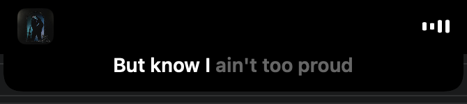
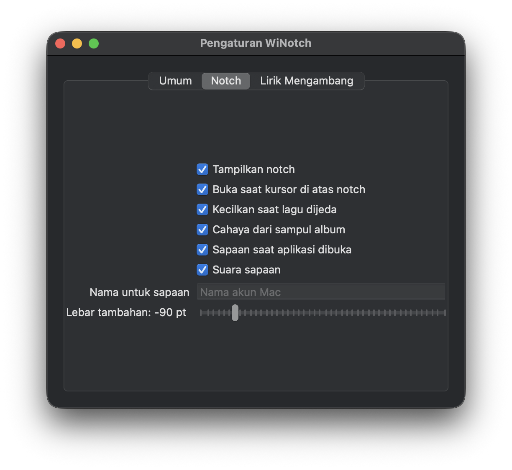

# WiNotch

WiNotch is a macOS menu bar app that shows synced lyrics in the MacBook notch. Play a song in
Spotify and the current line appears under the notch, lit up word by word when timing data
exists. Move the pointer over the notch and it opens into a small player with the cover, the
controls and the next few lines.

I built it for myself, so the interface is in Indonesian. Spotify is the player I test with. The
Apple Music code is in place but hasn't met a real song yet.



## What it does

- Finds lyrics on its own. LRCLIB comes first, with NetEase and QQMusic as a fallback. Word timing
  comes from QQMusic, Kugou or NetEase when a result passes the checks in
  [lyrics-sources.md](docs/lyrics-sources.md).
- Shows the active line in the closed notch. On hover it opens with the cover, title, artist,
  progress, playback controls and four lines of lyrics, and a single haptic tap marks the moment
  it opens.
- Lights the open notch with a slow glow taken from the album cover's colors
  ([album-color.md](docs/album-color.md)).
- Says hello at launch: two eyes appear in the notch, look around, smile, and make way for
  "Hello, Welcome [name]!" ([greeting.md](docs/greeting.md)).
- Has a floating lyrics window you can drag anywhere, with its own font size, width, alignment,
  colors, next-line preview, and options to hide on pause or fade on hover.
- Lets you search lyrics by hand, shift the timing for one song or for all of them (handy with
  Bluetooth speakers), and clear the lyrics cache.



## Requirements

- An Apple Silicon Mac on macOS 14.6 or later. I build and test it on a MacBook with a notch.
- The Swift 6.2 toolchain or newer (Xcode 26 or its command line tools).
- An Apple Development certificate in your keychain. The build script signs the app with it, so
  macOS remembers the Automation permission from one build to the next.

## Build and run

```bash
cd app
./build-app.sh            # builds and signs app/build/WiNotch.app
./build-app.sh install    # does the same, then copies it to /Applications
```

The first time WiNotch reads Spotify, macOS asks for Automation permission. Without it, Spotify
reports the playback position as 0 and raises no error, so WiNotch checks the permission itself
and shows a short guide instead of trusting the 0.

To add an app icon, put a 1024×1024 image at `app/Resources/AppIcon.png` before you build.

Tests:

```bash
cd app/NotchLyricsCore && swift test
```

## How it's built

Most of the code lives in one Swift package, `app/NotchLyricsCore`, split into modules you can
test without any UI:

| Module | Job |
|---|---|
| `PlaybackCore` | Player state, the playback clock, the Automation permission |
| `LyricsFinder` | Search, ranking, the credit-line filter, cache and offsets |
| `SyncEngine` | Picks the active line and schedules the next one |
| `AppState` | Observable app state and settings |
| `NotchUI` | The notch panel, its shape, its four sizes and hover |
| `FloatingUI` | The floating lyrics window |
| `LXMusicPlayer` | Talks to the music players over ScriptingBridge (see Credits) |

WiNotch doesn't poll on a timer for every frame. It schedules one wait until the next lyric line,
and when nothing plays, no timer runs at all. [architecture.md](docs/architecture.md) covers the
data flow and the early prototypes, and [hardening.md](docs/hardening.md) has the edge cases and
the CPU and memory numbers.

`NotchLyrics` is the working name you'll still see in the package, the executable and the bundle
identifier.

## Credits

- [LyricsKit](https://github.com/MxIris-LyricsX-Project/LyricsKit) (MxIris fork) provides the
  lyrics provider clients.
- `app/NotchLyricsCore/Sources/LXMusicPlayer` is a copy of `LXMusicPlayer` from the
  [MusicPlayer](https://github.com/MxIris-LyricsX-Project/MusicPlayer) package, under the Mozilla
  Public License 2.0. Its license file and file headers are kept as they were.
- [LRCLIB](https://lrclib.net) is the main lyrics source. NetEase, QQMusic and Kugou are
  unofficial APIs. WiNotch calls them once per new song and caches what comes back.
